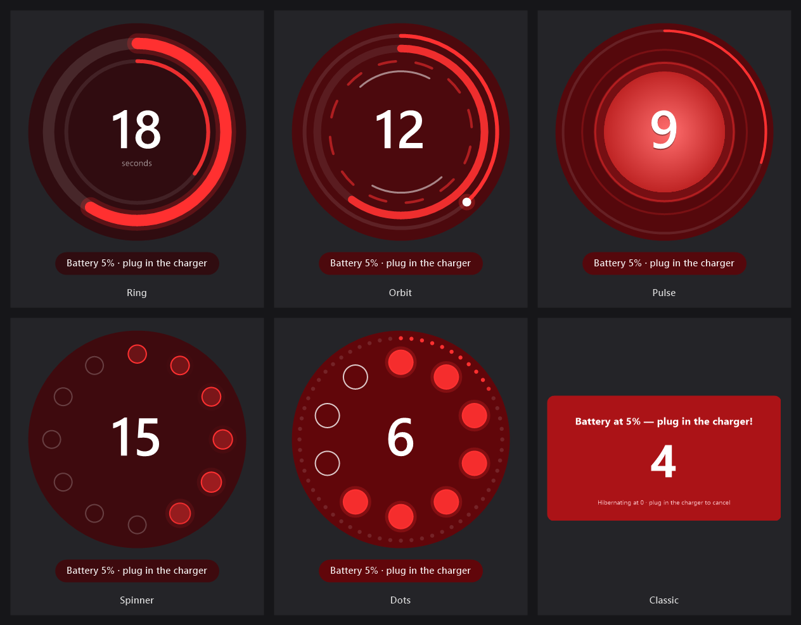

<p align="center"></p>

<h1 align="center">LastSecondsLeft</h1>

<p align="center">A tiny Windows tray app that gives your laptop a dramatic countdown before it dies.</p>



## Why

The low-battery notification is easy to ignore, because you know there's "still some time". LastSecondsLeft makes that time visible. When the laptop is **not charging** and the battery hits **5%**, a big animated **30 → 0** countdown floats on top of everything. At 0 the PC **hibernates**, so your open work is saved. Plug in the charger and the countdown disappears.

## Features

- 6 animated countdown styles: Ring, Orbit, Pulse, Spinner, Dots, Classic
- All in red, with a background that turns from near-black to deep red as time runs out
- Choose the start level (1–50 %), the length (5–600 s) and the size (50–95 % of the screen height)
- Never steals keyboard focus, so you can keep typing while it counts down
- Plugging in the charger cancels it; there's no snooze button and Alt+F4 doesn't close it
- Hibernates at 0, or does a normal shutdown if hibernation is disabled
- Very light: while idle it only checks the battery every 10 s, and the animation runs only while a countdown is on screen
- A single small `.exe` with no dependencies, built with the C# compiler that ships with Windows

## Install

1. Download this repository (**Code → Download ZIP**) and extract it.
2. Open the folder in **File Explorer** and double-click **`install.bat`**.

If there's no `LastSecondsLeft.exe` yet, `install.bat` builds it from the source first, so nothing else needs to be installed. The installer:
- copies the app to `%LOCALAPPDATA%\LastSecondsLeft`
- starts it now and at every login (current user only, no admin rights needed)

> **Windows SmartScreen:** the app isn't code-signed, so Windows may show a blue "Windows protected your PC" warning. Click **More info → Run anyway**. You can read the whole source in `LastSecondsLeft.cs`.

## Use

Find the logo in the tray (click `^` near the clock).

- **Double-click** it, or right-click it → **Settings…**, to pick the style, start level, length and size. **Preview** shows the selected style.
- Right-click → **Test countdown (safe)** shows a countdown that never hibernates. A test countdown closes with a click.

Settings are saved in `%LOCALAPPDATA%\LastSecondsLeft\settings.ini`.

## Styles

| Style | Look |
|---|---|
| Ring | a thick ring that empties as time runs out, plus an inner ring that fills once per second |
| Orbit | four rings: time left with a glowing head, a per-second sweep, rotating dashes, counter-rotating arcs |
| Pulse | a heart that beats every second and sends out ripples |
| Spinner | 12 dots with a loading-style comet going round once per second; dots go dark as time runs out |
| Dots | 10 dots that light up one by one every second, plus 60 tiny dots for the time left |
| Classic | a simple red box |

## Uninstall

Double-click **`uninstall.bat`**. It stops the app, removes it from startup and deletes its folder and settings.

## Build from source

Needs Windows 10 or 11, which already includes .NET Framework 4.x and its C# compiler.

```bat
build.bat
```

This creates `LastSecondsLeft.exe`. The logo is drawn in code: on the first build the app writes `LastSecondsLeft.ico` itself, and the exe is then rebuilt with it.

For development, the exe also takes these arguments:

| Argument | What it does |
|---|---|
| `/demo[:Style] [/seconds:N] [/size:N]` | shows one test countdown, then exits |
| `/writeicon:<path>` | saves the logo as a multi-size `.ico` |
| `/snapshots:<folder>` | renders `logo.png` and `styles.png` (the images in this README) without opening any window |

## Files

| File | What |
|---|---|
| `LastSecondsLeft.cs` | all the source code |
| `LastSecondsLeft.ico` | the logo, generated by the app itself |
| `build.bat` | builds the exe |
| `install.bat` / `uninstall.bat` | install / remove |
| `docs/` | README images |

## License

[MIT](LICENSE)
